# Setup guide with screenshots

Red numbers in the screenshots are the click order, 1 to 33 across the whole guide.
Identifiers in the screenshots are blurred.

## 0. What you need

You enter 5 values in SOCRadar and 1 value in the Azure deployment form.
Order: create an app in Microsoft Entra ID (1-3), deploy (4), copy the deployment outputs (5), fill the SOCRadar form (6).
The deployment needs the app's Object ID, and SOCRadar needs the deployment outputs.

| Value | Goes to | Where you find it | Section |
|-------|---------|-------------------|---------|
| Tenant ID (Directory ID) | SOCRadar | App Overview page | 1.2 |
| Application (client) ID | SOCRadar | App Overview page (same screen) | 1.2 |
| Application secret | SOCRadar | Certificates & secrets | 2.0, 2.1 |
| Service Principal Object ID | Azure deployment form | Enterprise application page | 3.0, 3.1 |
| Data Collection Endpoint URI | SOCRadar | Deployment outputs | 5.0, 5.1 |
| Data Collection Rule immutable ID | SOCRadar | Deployment outputs (same screen) | 5.1 |

You need rights to create an app registration, and Owner or User Access Administrator on the resource group.
No API permissions and no admin consent.

## 1.0 App registrations

1. Search **App registrations** in the top search box and open it.
2. **New registration**.

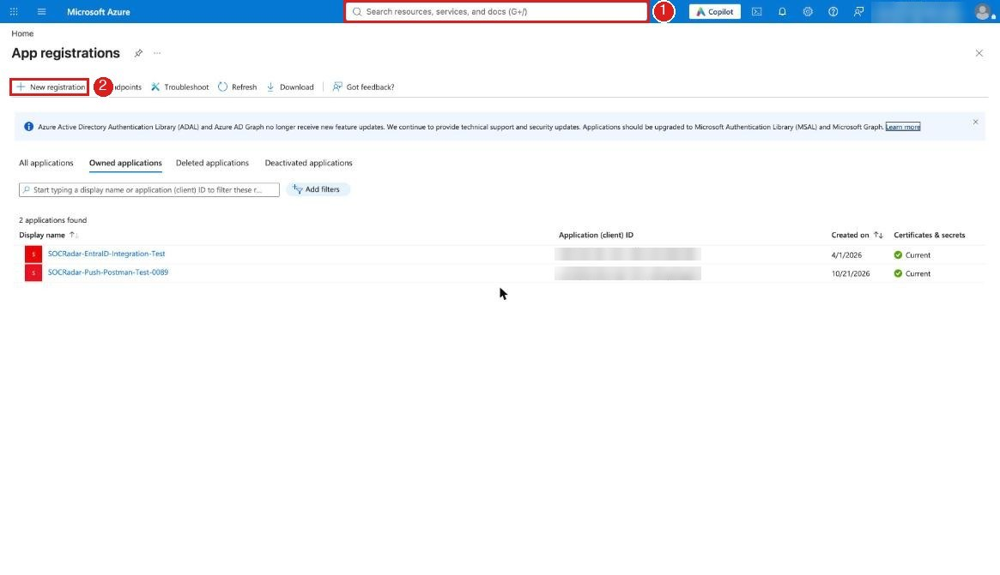

## 1.1 Register an application

3. **Name**: any name, for example `SOCRadar-Sentinel-Push`.
4. **Supported account types**: keep the default (single tenant).
5. **Redirect URI**: leave empty.
6. **Register**. The app's Overview page opens.

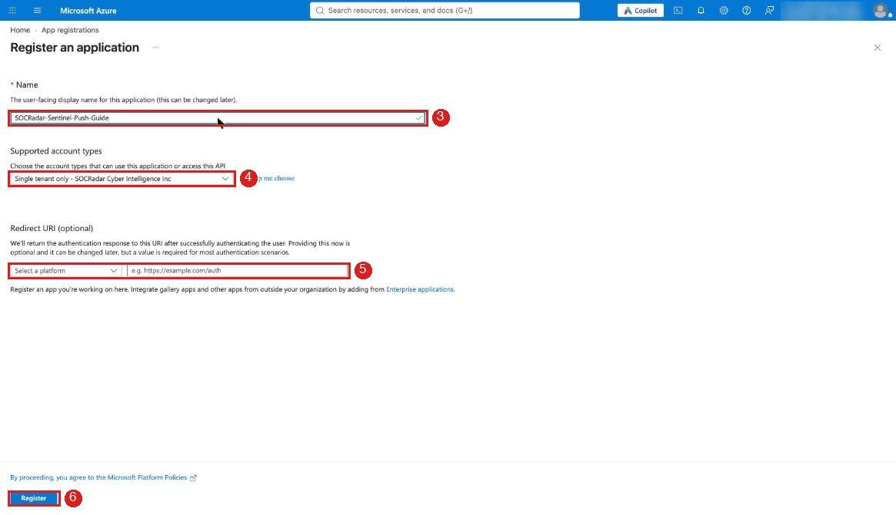

## 1.2 Overview: Tenant ID and Client ID

7. Copy **Application (client) ID**. Goes to SOCRadar *Application (client) ID*.
8. Copy **Directory (tenant) ID**. Goes to SOCRadar *Tenant ID*.
9. Click **Add a certificate or secret** next to Client credentials.

The **Object ID** on this page is not the one you need. The right one is in 3.1.

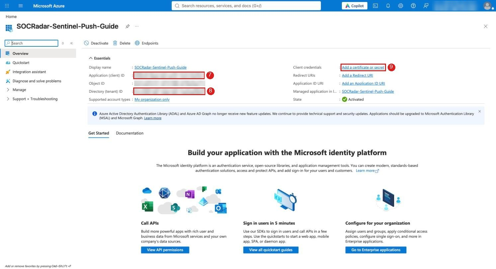

## 2.0 Certificates & secrets

10. **New client secret**. A panel opens on the right.
11. Enter a description, pick an expiry (when it expires alarms stop until you enter a new secret in SOCRadar), **Add**.

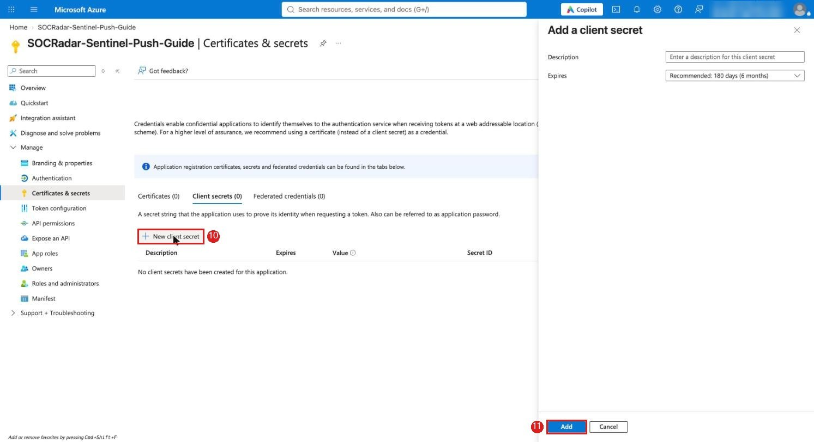

## 2.1 Copy the secret value

12. Copy the **Value** of the new row right away with the copy icon. Goes to SOCRadar *Application secret*.
    It is shown only once. **Secret ID** is not the secret.
13. Click **Overview** at the top of the left menu.

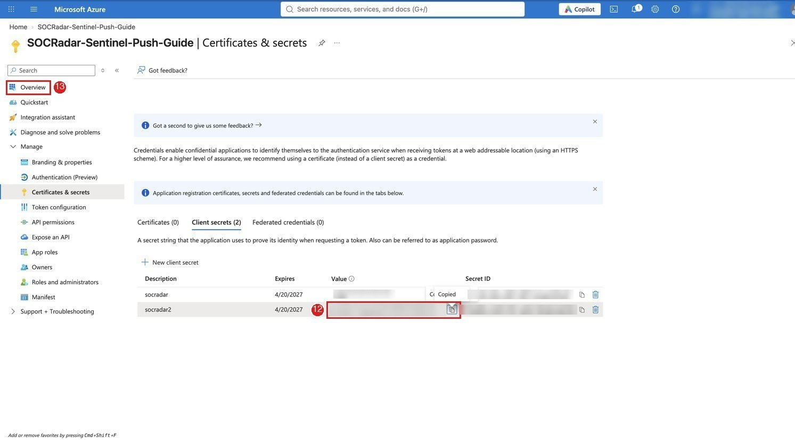

## 3.0 Overview: Managed application

14. Click the app name next to **Managed application in local directory**.

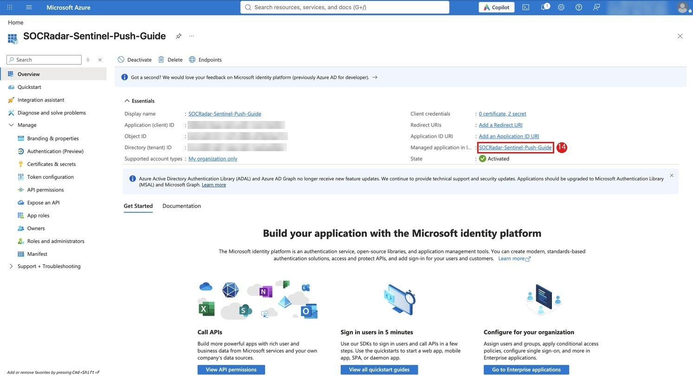

## 3.1 Enterprise application: Object ID

15. Copy **Object ID**. Goes to **Service Principal Object Id** in the deployment form (19), not to SOCRadar.
    No trailing dot or space, otherwise the deployment fails with `InvalidPrincipalId`.

Or with Azure CLI: `az ad sp show --id <Application (client) ID> --query id -o tsv`

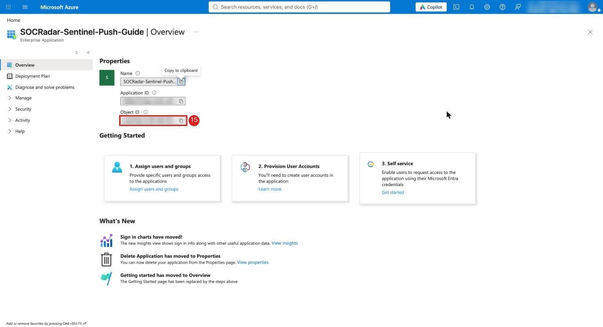

## 4.0 Deploy to Azure

16. **Deploy to Azure** in the [README](../README.md#2-deploy). The Custom deployment form opens.

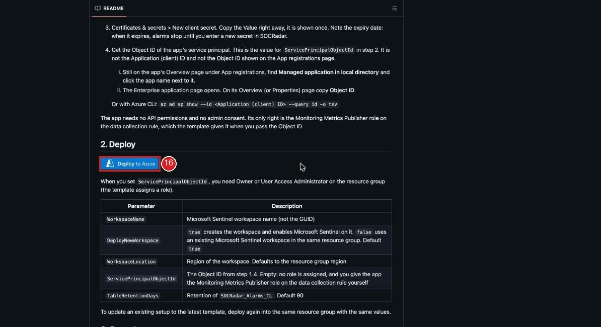

## 4.1 Custom deployment form

Check the subscription. Region can stay as is.

17. Resource group: the one that already holds your Microsoft Sentinel workspace. **Create new** only works together with `Deploy New Workspace = true` in step 18.
18. **Workspace Name**. The default `Deploy New Workspace = false` uses an existing Microsoft Sentinel workspace in
    the resource group you chose; a name that does not exist fails before anything is created. Set it to `true` to
    create the workspace and enable Microsoft Sentinel.
19. **Service Principal Object Id**: the Object ID from 15.
20. **Review + create**, then **Create**. Takes 1-2 minutes.

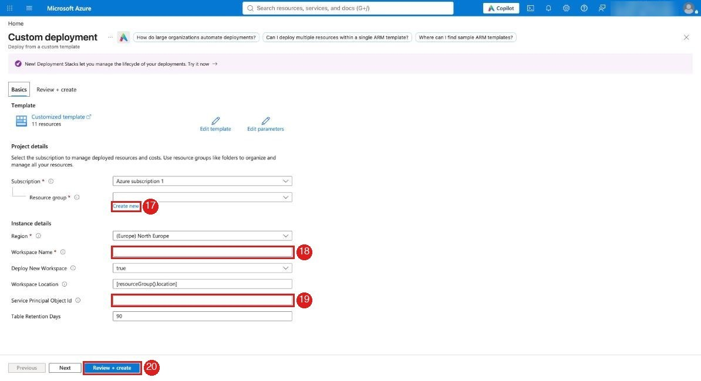

## 4.2 Deployment complete

21. **Go to resource group**.

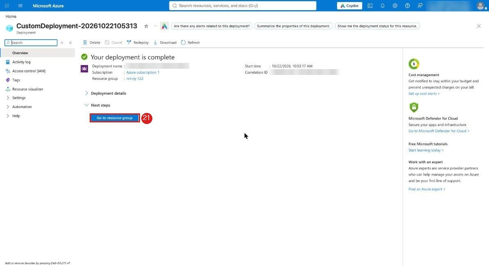

## 5.0 Resource group > Deployments

22. Left menu **Settings** > **Deployments**.
23. Click the deployment (Succeeded).

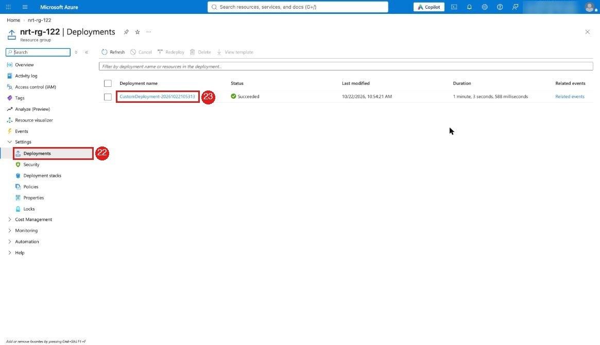

## 5.1 Outputs

Left menu **Outputs**.

24. Copy **dceUri** (`https://...ingest.monitor.azure.com`). Goes to SOCRadar *Data Collection Endpoint URI*.
25. Copy **dcrImmutableId** (`dcr-...`). Goes to SOCRadar *Data Collection Rule immutable ID*.

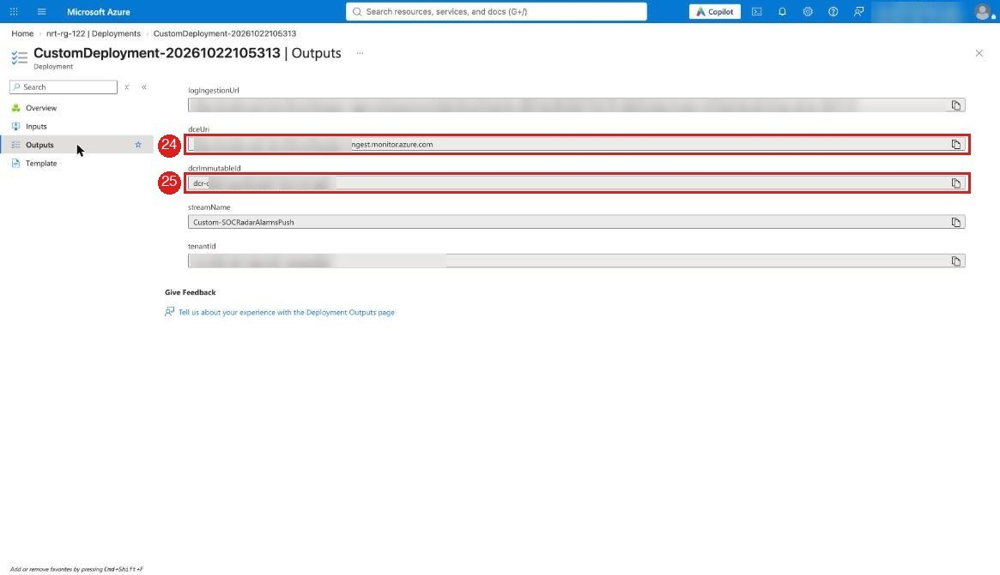

## 5.2 No outputs? Read them from the resources

The same two values are on the resources in the resource group.

24. **SOCRadar-Push-DCE** (Data collection endpoint) > Overview > **Logs Ingestion**.
25. **SOCRadar-Alarms-Push-DCR** (Data collection rule) > Overview > **Immutable ID**.

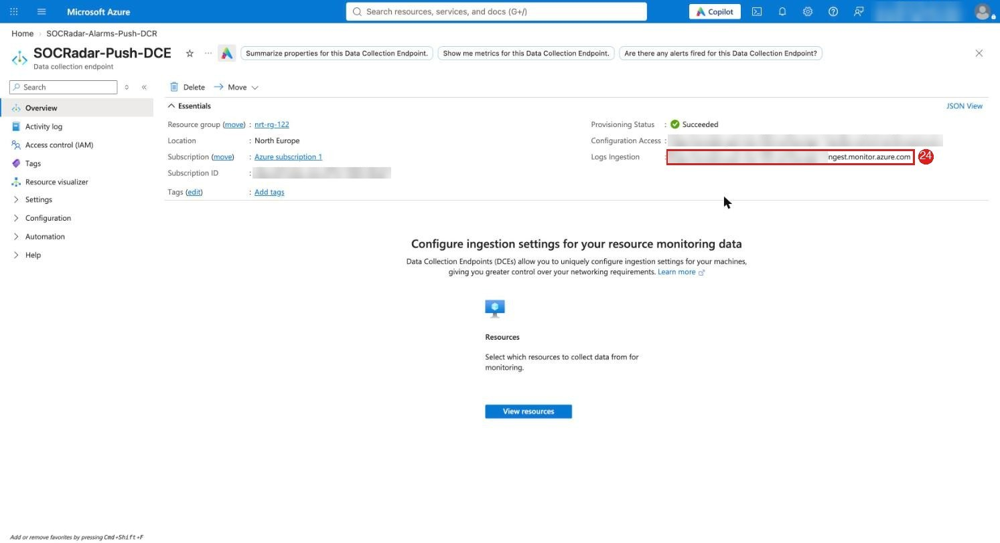
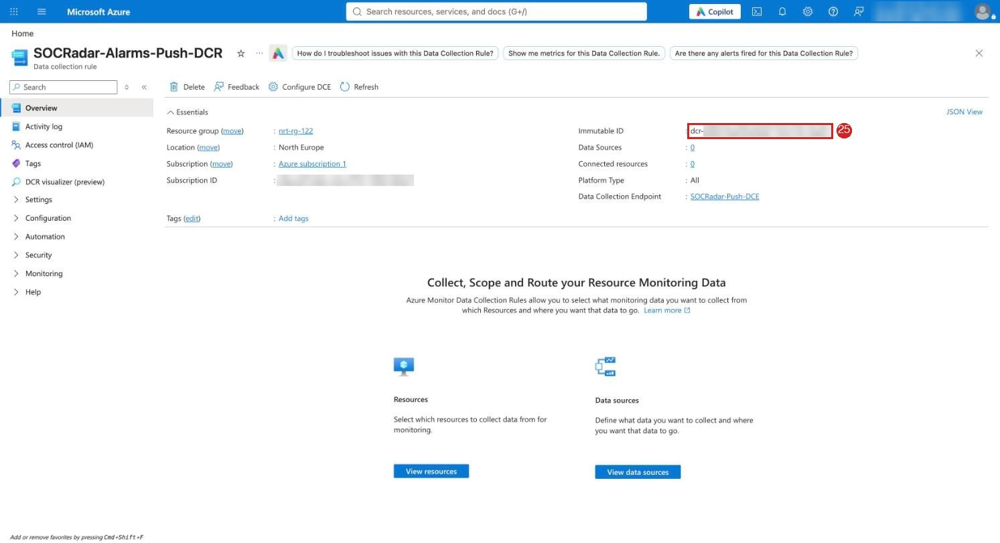

## 6.0 SOCRadar form

26. **Integration Name**: any name.
27. **Tenant ID (Directory ID)**: 8.
28. **Application (client) ID**: 7.
29. **Application secret**: 12 (the Value, not the Secret ID).
30. **Data Collection Endpoint URI**: 24.
31. **Data Collection Rule immutable ID**: 25.
32. **Test Connection** (optional).
33. **Add Integration**.

The first alarm takes about 6 minutes to reach a new table, later ones a few seconds.
An incident opens 3-6 minutes after the row arrives.

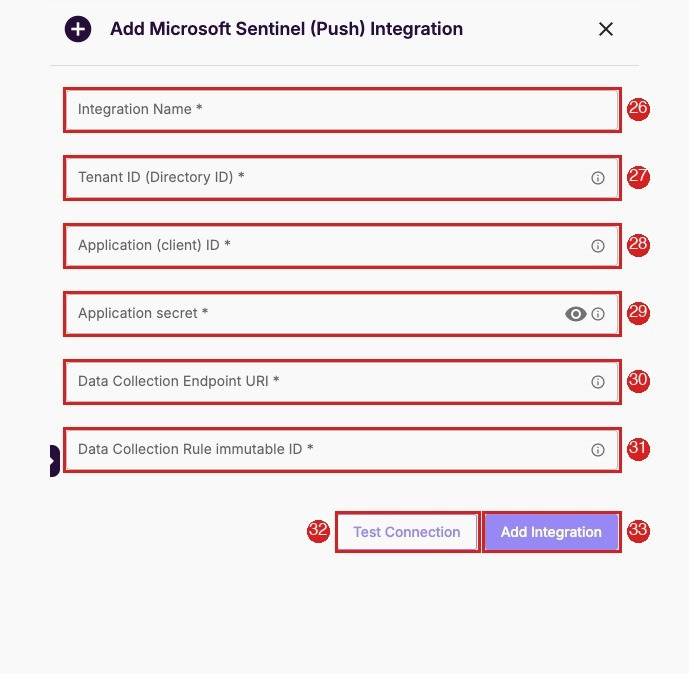
