# Setup guide

Follow these steps to connect SOCRadar alarms to Microsoft Sentinel, verify a connection test,
and check the next real alarm in Log Analytics and Microsoft Defender.

The screenshots use red numbers 1 to 33. Identifiers are blurred. Follow the text for current
defaults, output names and table names. The deployment image shows `true`, while the template
defaults `DeployNewWorkspace` to `false`.
Some screenshots also show older table or resource labels. Use `SOCRadar_Push_Alarms_CL` and
`SOCRadar-Alarms-Push-DCR` from the current instructions rather than copying those older labels.

## 0. What you need

You enter 5 values in SOCRadar and 1 value in the Azure deployment form.
Order: reuse a suitable app in Microsoft Entra ID, or create one only if needed (1-3), deploy (4), copy the deployment outputs (5), fill the SOCRadar form (6).
The deployment needs the app's Object ID, and SOCRadar needs the deployment outputs.

| Value | Goes to | Where you find it | Section |
|-------|---------|-------------------|---------|
| Tenant ID (Directory ID) | SOCRadar | App Overview page | 1.2 |
| Application (client) ID | SOCRadar | App Overview page (same screen) | 1.2 |
| Application secret | SOCRadar | Secure store for an existing secret; Certificates & secrets for a new secret. Azure cannot display an existing secret value again | 2.0, 2.1 |
| Service Principal Object ID | Azure deployment form | Enterprise application page | 3.0, 3.1 |
| Data Collection Endpoint URI | SOCRadar | Deployment outputs | 5.0, 5.1 |
| Data Collection Rule immutable ID | SOCRadar | Deployment outputs (same screen) | 5.1 |

Before starting:

- Select the intended **Directory/tenant** and **Subscription** in Azure.
- Have access to the selected app and its securely stored secret, or permission to add a secret
  to that same app. Create an app only when no suitable registration exists.
- Have Owner, or Contributor plus User Access Administrator, for resource creation and role assignment.
  Have workspace log-read and incident-read access for the final checks.
- Keep secrets and customer data private when sharing diagnostic information.

No additional Microsoft Graph API permission or admin consent is required for this sender. The app's
send permission is an Azure role on the DCR. Do not remove permissions a reused app needs elsewhere.

## 1.0 App registrations

First, open Microsoft Entra ID > App registrations > **All applications** and filter by name for an existing SOCRadar Push/DCR app registration. Reuse a suitable registration in your tenant. Copy its Application (client) ID and Directory (tenant) ID in 1.2, and its service principal's Object ID in 3.1. If you have a securely stored, unexpired client secret, use it and skip 2.0-2.1. If no usable secret is stored, create a new client secret on the **same app registration** in 2.0-2.1. Do not delete or replace a secret used by another integration.

1. Search **App registrations** in the top search box and open it.
2. Only if no suitable registration exists, select **New registration** and follow 1.1. Otherwise open the existing registration and continue at 1.2.

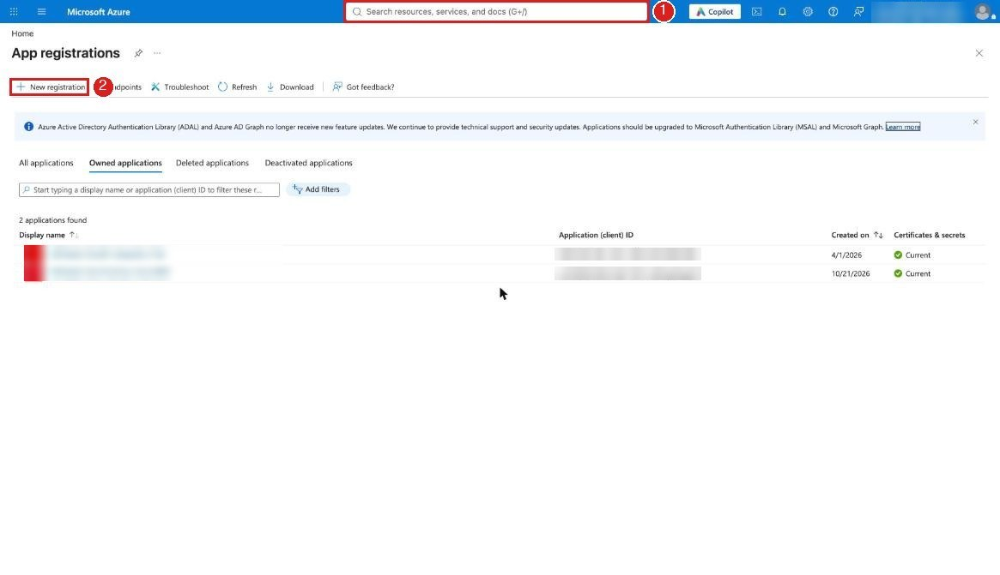

## 1.1 Register an application

3. **Name**: any name, for example `SOCRadar-Sentinel-Push`.
4. **Supported account types**: keep the default (single tenant).
5. **Redirect URI**: leave empty.
6. **Register**. The app's Overview page opens.

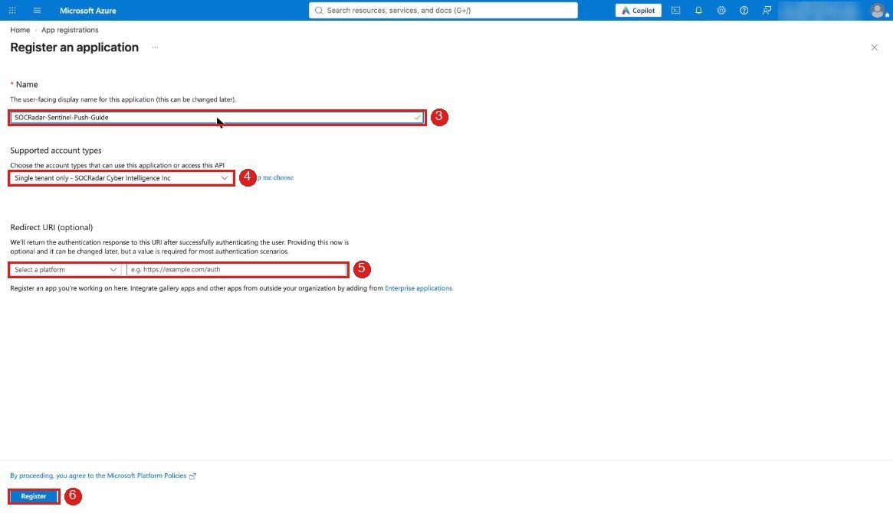

## 1.2 Overview: Tenant ID and Client ID

7. Copy **Application (client) ID**. Goes to SOCRadar *Application (client) ID*.
8. Copy **Directory (tenant) ID**. Goes to SOCRadar *Tenant ID*.
9. If you need a new secret, click **Add a certificate or secret** next to Client credentials and follow 2.0-2.1.
   If you already have a securely stored, unexpired secret, use it and continue at 3.0.

The **Object ID** on this page is not the one you need. The right one is in 3.1.

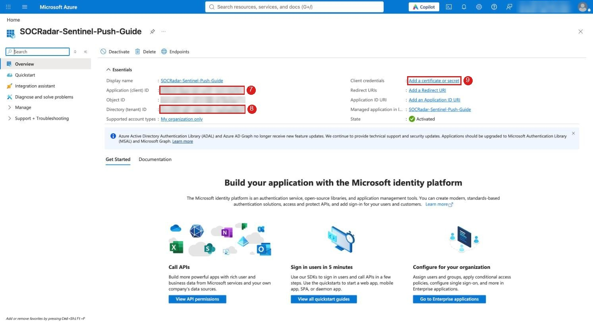

## 2.0 Certificates & secrets

10. **New client secret**. A panel opens on the right.
11. Enter a description, pick an expiry (when it expires alarms stop until you enter a new secret in SOCRadar), **Add**.

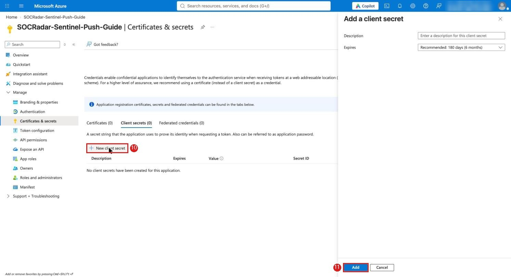

## 2.1 Copy the secret value

12. Copy the **Value** of the new row right away with the copy icon. Goes to SOCRadar *Application secret*.
    It is shown only once. **Secret ID** is not the secret.
13. Click **Overview** at the top of the left menu.

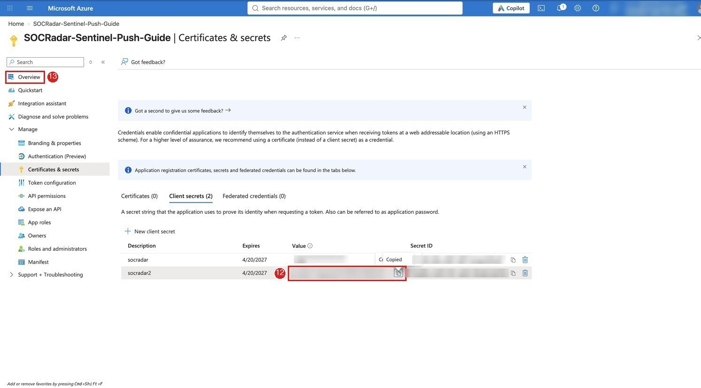

## 3.0 Overview: Managed application

14. Click the app name next to **Managed application in local directory**.

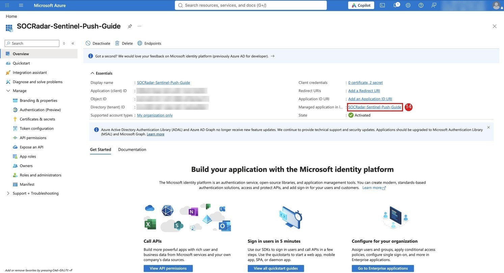

## 3.1 Enterprise application: Object ID

15. Copy **Object ID**. Goes to **Service Principal Object Id** in the deployment form (19), not to SOCRadar.
    No trailing dot or space, otherwise the deployment fails with `InvalidPrincipalId`.

Or with Azure CLI: `az ad sp show --id <Application (client) ID> --query id -o tsv`

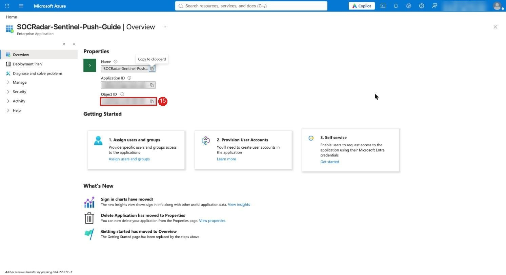

## 4.0 Deploy to Azure

16. Open the [Deploy to Azure button](../README.md#2-deploy). The Custom deployment form opens.

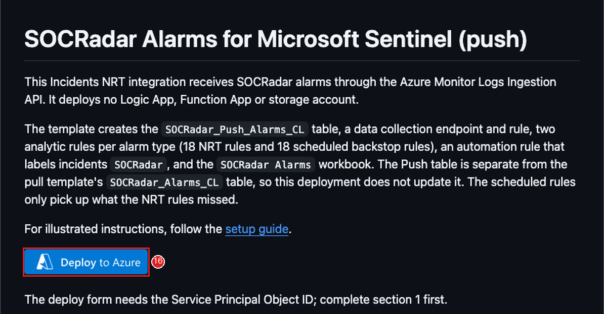

## 4.1 Custom deployment form

Check Directory/tenant and Subscription again before creating resources.

17. **Resource group**: select the group containing your existing Sentinel workspace, or choose
    **Create new** for a new workspace.
18. **Workspace Name** (`WorkspaceName`): enter your existing Sentinel workspace name and leave
    **Deploy New Workspace** (`DeployNewWorkspace`) at its default `false`. The workspace must exist
    in the selected resource group. To create a workspace instead, use an unused name and set this
    parameter to `true`; this also enables Microsoft Sentinel. Set **Workspace Location**
    (`WorkspaceLocation`) to the workspace's region. Leave **Table Retention Days** (`TableRetentionDays`)
    at 90 unless your policy requires another value.
19. **Service Principal Object Id** (`ServicePrincipalObjectId`): the Object ID from 15.
20. **Review + create**, then **Create**. Wait for **Succeeded**; a pending deployment is not ready.

Expected: `SOCRadar_Push_Alarms_CL`, DCE, DCR, 18 NRT + 18 scheduled rules, the labeling automation
rule and workbook in your workspace. A workspace is created only when `DeployNewWorkspace=true`.
If deployment fails, open its failed operation and read the error. Check tenant, region, principal Object ID
and role-assignment rights. Do not continue with partial resources or claim a successful setup.

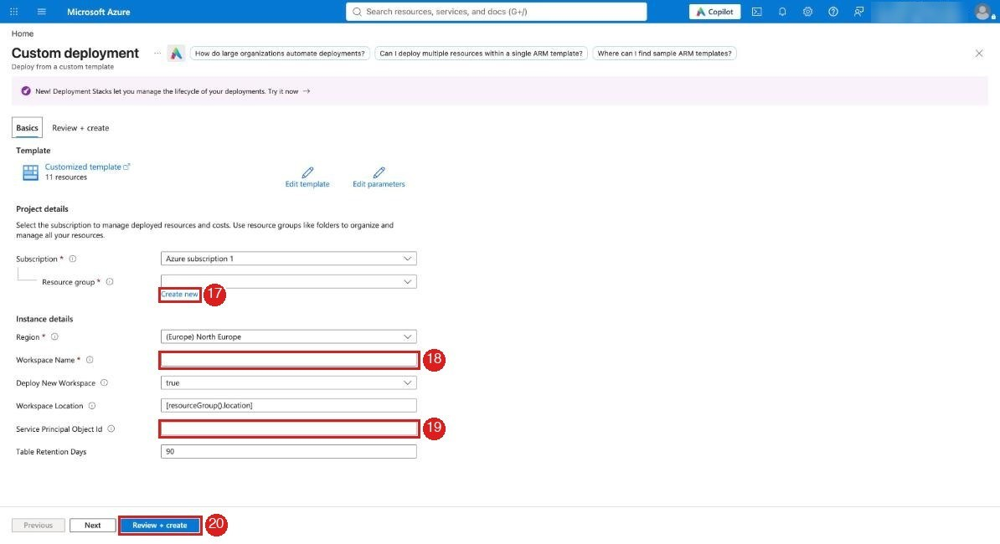

## 4.2 Deployment complete

21. **Go to resource group**.

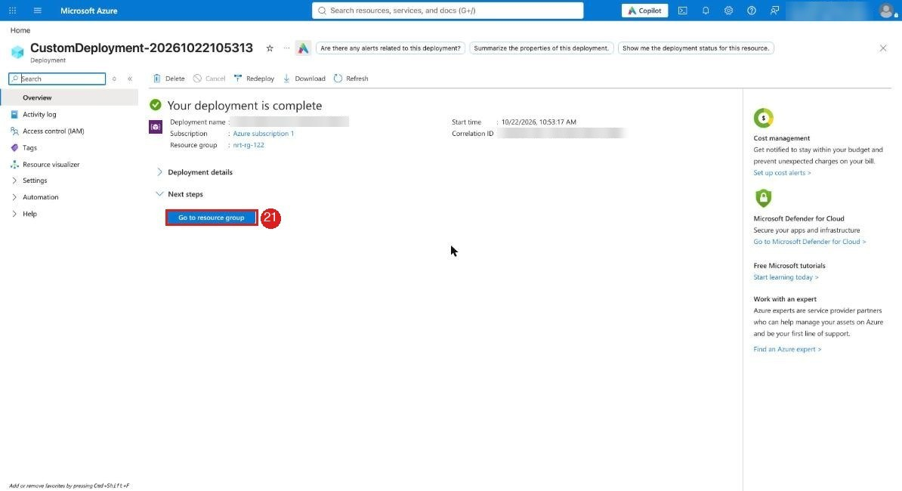

## 5.0 Resource group > Deployments

22. Left menu **Settings** > **Deployments**.
23. Click the deployment (Succeeded).

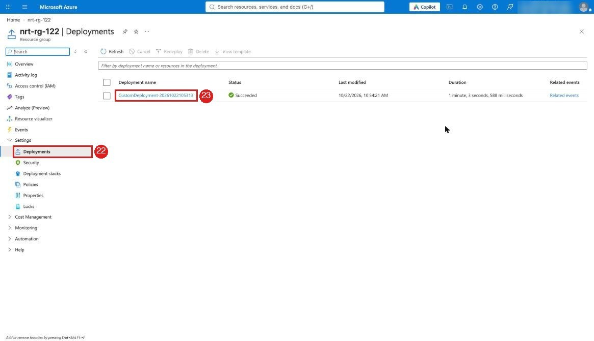

## 5.1 Outputs

Left menu **Outputs**.

24. Copy **DceUri** (`https://...ingest.monitor.azure.com`). Goes to SOCRadar *Data Collection Endpoint URI*.
25. Copy **DcrImmutableId** (`dcr-...`). Goes to SOCRadar *Data Collection Rule immutable ID*.

Also check **TenantId**, **StreamName** = `Custom-SOCRadarAlarmsPush` and **LogIngestionUrl**.
The existing screenshot uses lower-case initial letters. Copy your deployment's current values. DCR **Immutable ID** is different from the DCR's ARM resource ID.

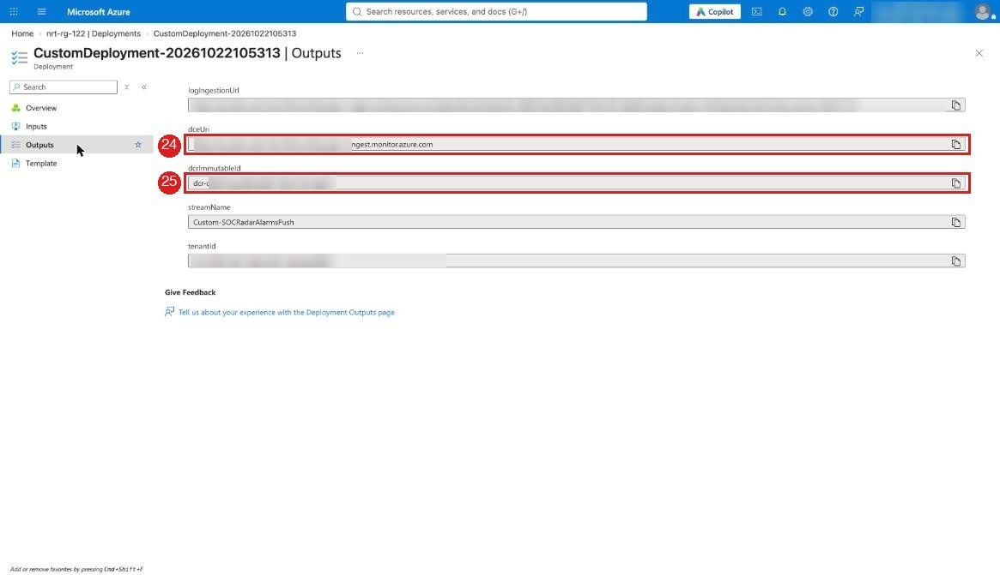

## 5.2 No outputs? Read them from the resources

The same two values are on the resources in the resource group.

24. **SOCRadar-Push-DCE** (Data collection endpoint) > Overview > **Logs Ingestion**.
25. **SOCRadar-Alarms-Push-DCR** (Data collection rule) > Overview > **Immutable ID**.

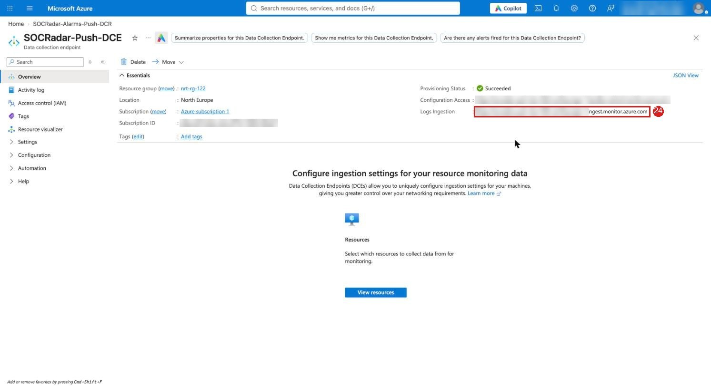
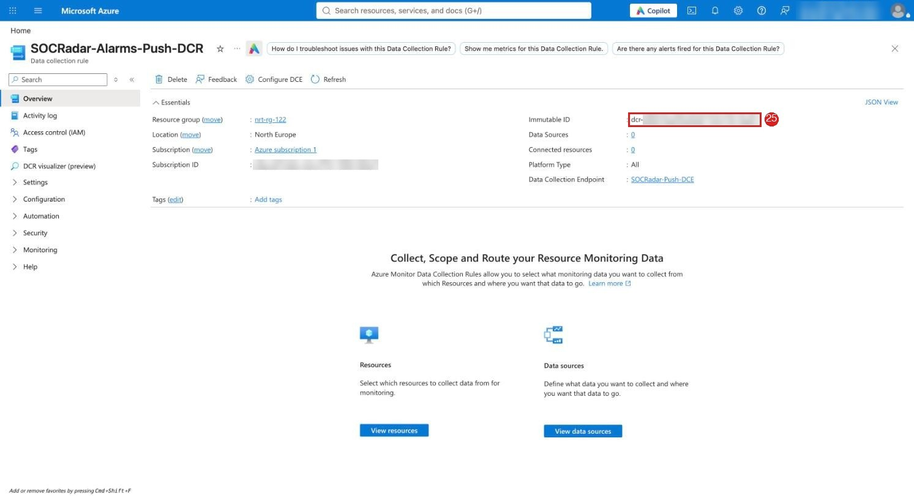

### Check the app's send role

Open **SOCRadar-Alarms-Push-DCR > Access control (IAM) > Role assignments**. Find the selected
Enterprise application and **Monitoring Metrics Publisher**. Its scope must be this DCR, not the DCE
or the whole subscription. The template creates it when `ServicePrincipalObjectId` is supplied.
If it is missing, stop and correct the selected principal/scope before testing. No admin-consent screen
is part of this role check.

## 6.0 SOCRadar form

In SOCRadar, open **Integrations > Microsoft Sentinel (Push)**.
Use the selected app and your deployment's outputs.

26. **Integration Name**: any name.
27. **Tenant ID (Directory ID)**: 8.
28. **Application (client) ID**: 7.
29. **Application secret**: 12 (the Value, not the Secret ID).
30. **Data Collection Endpoint URI**: 24.
31. **Data Collection Rule immutable ID**: 25.
32. **Test Connection**. See section 7.0; a successful test does not create an incident.
33. **Add Integration** to save. If the current UI labels this **Save**, use that control and verify the
    configuration is saved. Keep the application secret private.

Expected: a saved integration with these five connection values and a successful connection-test
result. A token error points to tenant/client ID, secret value/expiry or the DCR role. Keep the
secret private when diagnosing errors. Field layout can differ from this screenshot.

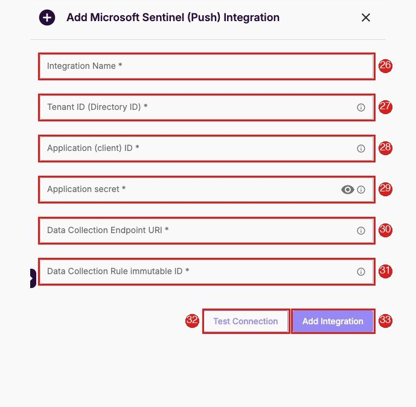

## 7.0 Test Connection

Select **Test Connection** in SOCRadar. Open your workspace in Azure > **Logs** and run:

```kusto
SOCRadar_Push_Alarms_CL
| where TimeGenerated > ago(1d)
| where EventType == "connection.test"
| project TimeGenerated, IngestedAt=ingestion_time(), EventType
| order by TimeGenerated desc
```

Expected: a connection-test row. The analytic rules exclude `connection.test`, so
**Test Connection opens no incident**. A successful button result alone does not prove a real alarm
reached Azure. If a message names the older `SOCRadar_Alarms_CL` table, query this deployment's
`SOCRadar_Push_Alarms_CL` table and check its workspace and DCE/DCR.

If the row is absent, check the time range, workspace, DCE URI, DCR immutable ID, stream and
DCR-scoped role. Allow for initial ingestion delay before checking again. Do not repeatedly select
Test Connection or resend an alarm while its delivery result is unknown.

## 8.0 Verify the first real alarm

1. Wait for the next real `alarm.created` / `OPEN` alarm after saving the integration.
   Delivery applies to new alarms and does not backfill history.
2. In the saved SOCRadar integration, open **Recent Deliveries** and select that alarm. Inspect its
   request and response details. If the list appears stale, reload once. The integration overview's
   summary fields do not replace the actual delivery details.
3. Match its `AlarmId` and company to the row in your `SOCRadar_Push_Alarms_CL` table using section 9.0.
4. Follow section 10.0 to find its alert and related incident in Defender.

Measured in 3 test runs: send to table row took about 4 to 375 seconds, and row to NRT alert
took about 143 to 187 seconds; this is not a guarantee. Incident creation, visibility and tagging can
take longer, as described in section 10.2. Wait at least 30 minutes after sending before declaring
an incident missing.
If no new alarm arrives, wait for the next real alarm; Test Connection cannot validate incident creation.

## 9.0 Verify the row in Log Analytics

Measured in 3 test runs: send to table row took about 4 to 375 seconds; this is not a guarantee.

Open your **workspace > Logs** and replace the placeholder with the actual alarm ID:

```kusto
let alarmId = "<alarm ID>";
SOCRadar_Push_Alarms_CL
| where TimeGenerated > ago(1d) and AlarmId == alarmId
| where EventType != "connection.test"
| project AlarmKey=hash_sha256(AlarmId), EventType, Status, Severity,
          AlarmDate, RowTime=TimeGenerated, IngestedAt=ingestion_time(),
          AlarmTextChars=strlen(AlarmText), PayloadType=gettype(AlarmPayload),
          ContentKeyCount=array_length(bag_keys(AlarmPayload.content)), TagCount=array_length(Tags)
```

Check the matching row, `alarm.created`, `OPEN`, severity and dynamic payload.
A connection-test row can exist separately. Compare all 17 fields below with the source alarm;
a nonempty payload or HTTP 204 alone does not prove completeness. Dates can use different UTC
formatting, and object keys can appear in a different order without changing their meaning.

| Row field | Expected value |
|---|---|
| `AlarmId` | Source `alarm_id` as a string |
| `CompanyId` | Source company ID as a string |
| `AlarmMainType` | `alarm_type_details.alarm_main_type` |
| `AlarmSubType` | `alarm_type_details.alarm_sub_type` |
| `Severity` | Source `alarm_risk_level`, upper-cased |
| `Status` | Source status |
| `Title` | `alarm_type_details.alarm_generic_title`, or up to 200 characters of the first line of `alarm_text` |
| `AlarmText` | Source `alarm_text`, limited to 4000 UTF-16 code units |
| `AlarmDate` | Source `date` as an ISO-8601 UTC timestamp |
| `AlarmPayload` | Original source fields except `alarm_text`; retains content, types, arrays and nulls |
| `EventType` | `alarm.created` for a new alarm |
| `CompanyName` | Source company name when supplied, otherwise empty |
| `AlarmAsset` | Source `alarm_asset`; structured assets serialized as a JSON string, otherwise empty when absent |
| `AlarmUrl` | Link to the same source alarm |
| `Tags` | Source tags array |
| `AlarmUpdatedAt` | Source `last_notification_date` as an ISO-8601 UTC timestamp, or empty when absent |
| `ConnectorVersion` | Sender version identifier |

If no row is visible, check the query time range and workspace first, then endpoint, stream, role
and delivery response. Check at 5, 15 and 30 minutes after sending; if the row remains absent,
use the delivery details to investigate. A failed query is not an empty result.
Do not resend to speed up ingestion. More than one matching row can indicate a duplicate or replay.
For custom API troubleshooting, validate JSON and its types before sending; requests must be under 1 MB.

## 10.0 Verify the alert and Defender incident

### 10.1 Connect your workspace to Defender

The template enables Microsoft Sentinel on the workspace. **Defender portal connection is a separate
step**. Open **Setup & configuration > Settings > Microsoft Sentinel > SIEM workspaces**, or
**System > Settings > Microsoft Sentinel > Connect a workspace**. Follow Microsoft's
[onboarding procedure](https://learn.microsoft.com/en-us/unified-secops/microsoft-sentinel-onboard):

1. Inspect your workspace in **SIEM workspaces**.
2. If it already shows **Connected**, skip reconnection. Connection state alone does not confirm
   alarm delivery or incident creation.
3. If it is not connected, select only your intended Sentinel workspace.
4. Keep an existing primary workspace unchanged and connect this workspace as **secondary**.
   Do not disconnect other workspaces.
5. For a tenant's first onboarding, follow Microsoft's primary-selection procedure with your
   administrator. If this is the only workspace, it becomes primary. Review those changes with the
   administrator before proceeding.
6. Confirm your workspace shows **Connected** before checking incidents in Defender.

Use Microsoft's [role and scope table](https://learn.microsoft.com/en-us/azure/sentinel/workspaces-defender-portal).
Secondary-only connection requires subscription-scoped Owner, or subscription-scoped User Access
Administrator plus Microsoft Sentinel Contributor at subscription, RG or workspace scope.
Owner for onboarding must be unconditional. First primary onboarding also requires Microsoft Entra
Security Administrator and the applicable Azure roles. **RG Owner alone is insufficient**.
If selection or connection is unavailable, ask your tenant administrator for help. This does not
require new App Registration permissions or application admin consent.

### 10.2 Inspect the alert and related incident

1. Open Microsoft Defender > **Investigation & response > Incidents & alerts > Incidents**.
   Some tenants call the queue **Cases**. If it looks empty, select **Reset all** and check the time
   range and workspace; a priority filter can hide incidents.
2. Search by the `[SOCRadar]` title prefix, then match `#<alarm id> - <title>`. The `SOCRadar` tag
   can arrive later, so tag filters can hide a new incident. Open the incident and related alert.
3. Check the alert's rule name: **SOCRadar alarm (NRT): <type>** identifies the NRT rule.
   **SOCRadar alarm: <type>** identifies the scheduled backstop rule, which catches alarms missed
   by NRT. Match the alert to the incident and source alarm.
4. Check the description, custom details and URL entity. Open **View in SOCRadar** to confirm that
   the link leads to the same source alarm. This integration supplies a URL entity; it does not add
   IP/DNS/Host entity enrichment, synchronization or daily rescans.

Measured in 2 completed test runs: alert to reported incident creation took about 8 to 100 seconds,
ARM visibility lagged creation by about 48 to 579 seconds, and the `SOCRadar` tag was recorded
about 66 to 962 seconds after creation; this is not a guarantee. One completed run used the
application's own identity (client credentials). Wait at least 30 minutes after sending before
declaring an incident missing.

The test tenant was connected to Defender and used incident provider Microsoft XDR. The test
workspace was not connected to the Defender portal, so these measurements do not establish portal
visibility timing. Timings can differ in tenants without Defender.

The five custom-detail keys are `AlarmId`, `AlarmMainType`, `AlarmSubType`, `SocradarSeverity`
and `AlarmStatus`. Raw `Severity` is upper-cased. Alert severity maps CRITICAL/HIGH to High,
MEDIUM to Medium and other values to Low.

Verify that the row, alert and incident refer to the same source alarm, with its type, status,
severity and content. A separate incident per alarm is not guaranteed: the same rule and URL can
group different `AlarmId` values into one incident. Duplicate or summary alerts can also appear;
check their counts. Large content and very long URLs have the limits described in
[Things to know](../README.md#things-to-know).

If the Cases alerts panel is empty or fails to load, check the matching `SecurityAlert` and
`SecurityIncident` records in your workspace, and confirm the incident through the Azure portal
or ARM API. Wait for panel loading to finish and compare the same incident in a fresh tab.
Keep organisation-wide Cases settings unchanged while investigating a single incident.

For KQL in Defender, use **Hunting > Advanced hunting** and confirm the workspace scope.
Workbooks show only the primary workspace in this experience. For a secondary workspace,
use Advanced hunting or Azure Logs.

Compare the source `AlarmDate`, delivery time, `ingestion_time()`, alert creation time and
incident creation time separately. An older source alarm date is not additional NRT processing delay.
